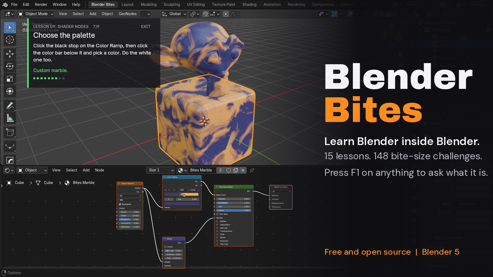
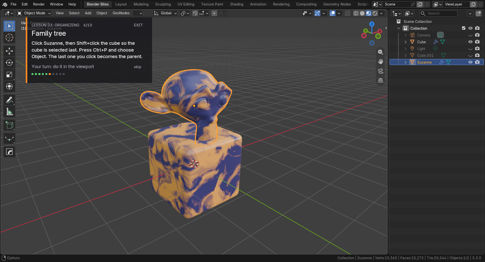
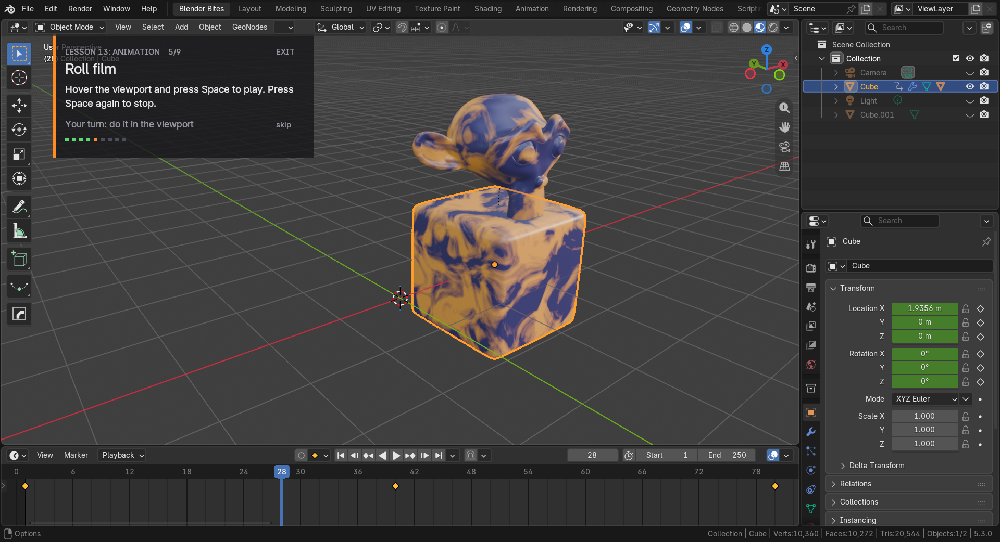

# Blender Bites



**Learn Blender inside Blender, one bite at a time.**

Blender's interface is a cockpit. Blender Bites hides almost all of it, hands you one viewport and a cube, and teaches you to fly a little at a time. Every lesson is a stack of tiny cards: read a line, do the thing in the real viewport, and the card notices you did it and moves on. Finish a lesson and part of the interface comes back as a reward: the header, the toolbar, the Outliner, the Properties editor, the Shader Editor, the Timeline. By the end you've earned the whole program back.

And anywhere, anytime: **hover anything and press F1** (or right-click a button and pick **EXPLAIN**) for a plain-language card about what it is, what it's for, and the shortcut.

Free and open source. Made by [Oscar Baechler](https://github.com/ogbog), author of *Blender By Example* and organizer of the Seattle Blender User Group.

## The lessons

| # | Lesson | You learn | The room grows |
|---|---|---|---|
| 00 | The Viewport | Orbit, zoom, pan, numpad views, select, frame, grab, axis locks, typed values, rotate, scale, undo | Header and toolbar |
| 01 | Seeing | The Z pie, X-ray, Material Preview, Rendered, overlays, T and N, typing numbers, F1 | Shift+A unlocks |
| 02 | Making | The 3D cursor, Shift+A, Adjust Last Operation, delete, duplicate, Suzanne, stacking | Outliner |
| 03 | Organizing | Selecting in the Outliner, renaming, hiding, parenting, collections | Properties |
| 04 | Properties | Properties tabs, resetting fields, Subdivision, Shade Smooth, the modifier stack | Tab (Edit Mode) unlocks |
| 05 | Edit Mode | Tab, vertex / edge / face select, moving geometry, select all, X-ray box select | |
| 06 | Modeling | Extrude, inset, loop cut, bevel, merge, delete | |
| 07 | Modifiers | Array, grids, Wireframe, live updates, removing and applying | |
| 08 | Materials | New materials, color, metal, roughness, two materials on one mesh | Shader Editor |
| 09 | Shader Nodes | Noise Texture, wiring, Color Ramp splicing, Bump | |
| 10 | Light | Rendered view, Area lights, power, color, softness, the World | |
| 11 | Camera | Camera view, camera to view, focal length, Lock Camera to View, depth of field | |
| 12 | Render | Engines, resolution, F12, saving the picture | Timeline |
| 13 | Animation | Keyframes, the Timeline, playback, scrubbing, animating rotation | |
| 14 | Graduation | Workspaces, saving your file, and the keys to the whole program | Everything |

15 lessons, 148 bites, 112 EXPLAIN entries.

| | |
|---|---|
|  |  |
| Lesson 03: the Outliner slides in | Lesson 13: keyframes and the Timeline |

## Install

1. Download `blender_bites-<version>.zip` from [Releases](https://github.com/ogbog/blender-bites/releases).
2. In Blender, open **Edit > Preferences > Get Extensions**, click the dropdown arrow at the top right, choose **Install from Disk...**, and pick the zip. (Dragging the zip onto the Blender window works too.)
3. **Help > Blender Bites > Continue.**

Requires Blender 5.0 or newer. Built and tested on Blender 5.3 on Windows.

## How it behaves

- **It never touches your stuff.** Learn mode runs in its own temporary "Blender Bites" workspace and deletes it when you leave. Your workspaces, preferences and keymaps stay exactly as they were. (It does teach on the objects in your scene, so start from a fresh file.)
- **Scroll the card** to move through reading cards. Challenges advance by themselves when you nail them. Stuck? A hint fades in after a few seconds, and **skip** is always there.
- **EXIT** on the card, or **Help > Blender Bites > Exit**, puts you back where you were.
- **Jump around** from **Help > Blender Bites**: every lesson is listed, with a check mark on the ones you've finished. Progress is saved locally on your machine. Nothing goes online.
- Some shortcuts stay locked until you've earned them (Shift+A in Lesson 01, Tab in Lessons 03 and 04). The card tells you when you try one early.

## Make your own lessons

Lessons are plain JSON in `blender_bites/content/`. A bite is a card plus a check:

```json
{
  "id": "grab-x",
  "title": "On rails",
  "body": "Press G, then X. The cube is now locked to the red X axis.",
  "setup": ["reset_cube", "select_cube"],
  "check": {"type": "operator", "idname": "TRANSFORM_OT_translate",
            "props": {"constraint_axis": [true, false, false]}}
}
```

Most checks read any Blender property by path, so new challenges need no Python:

```json
{"type": "prop", "root": "space", "path": "shading.type", "value": "WIREFRAME"}
{"type": "object", "object": "Cube", "path": "modifiers[0].type", "value": "BEVEL"}
{"type": "mesh", "object": "Cube", "what": "faces", "op": "ge", "value": 4, "rel": true}
```

Lessons 03 to 14 are generated by `tools/build_lessons.py`; run it after editing and it rewrites the JSON. EXPLAIN text lives in `blender_bites/content/explain_db*.json`, keyed by RNA path (`Object.location`), operator (`TRANSFORM_OT_translate`) or tool (`tool:builtin.extrude_region`).

`tools/harness.py` is the dev test rig: run inside Blender, it walks every bite of a lesson and checks that each challenge fails before the action and passes after it. `tools/package.py` builds the zip; `blender --command extension validate <zip>` double-checks it.

## Status

This is an early release (0.3.0). Lessons 00 to 02 have been played through by a human. Lessons 03 to 14 passed the automated harness, which simulates each challenge, but they still need a real human playthrough: some actions (toolbar toggles, gizmo drags, a real F12, the save dialog) can't be faked by a script. If a card doesn't notice something you clearly did, please [open an issue](https://github.com/ogbog/blender-bites/issues) and say which lesson and card.

## License

- Code: [GPL-3.0-or-later](LICENSE), like Blender itself.
- Lesson text and EXPLAIN text: [CC BY-SA 4.0](CONTENT-LICENSE.md). Remix them into your own course, keep the credit, share alike.

Written with Claude (Anthropic) as a coding and writing partner, directed, played and tested by Oscar Baechler. Part of [Seriously Open Games](https://github.com/ogbog).
